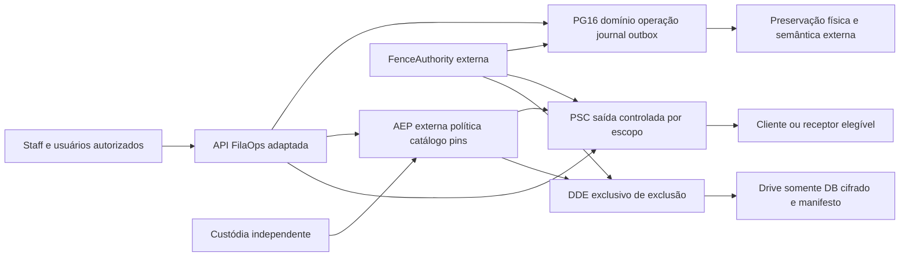

# Fundação — contrato documental r9 consolidado

## Identidade, precedência e alcance

GAEVA-MOD-001, mesma Task em contract_revision 9, draft, derivada do candidato documental r8 com PASS da QA na revisão anterior. Fonte S1 a32e81b13e6d1fe5a4008ceeea253aaec10461ff sem overlay; Task B é preimage documental, não raiz Git canônica estabelecida. A pesquisa r3/Discovery r6 tem quatro PASS históricos restritos. A cobertura formal de referência é Discovery r7, preservada por hash; os acréscimos humanos r8/r9 têm fontes e matriz complementar próprias. O aceite comunicado em 20/11 cobre o escopo documental r8/r9; a nova tupla consolidada precisa de QA independente. Gate formal UNKNOWN, sem G6 ou autorização operacional inferidos. A0 FAILED/P1 OPEN/P2P3 não liberadas; histórico de origem UNKNOWN não é resolvido retrospectivamente por builds futuros. Preservar todo fluxo antigo DF01–07 e suas condições antes das novas fases. #2–11 recebem dependências e não novas frentes nesta entrega.

Normativos para Fundação: contracts.md C1–C7, authority-protocol.md AP0–AP6, retention-protocol.md RP1–RP6 e este contrato de interfaces. O conteúdo transladado é identificado por hash/linhagem, sem ampliar PASS. Se texto genérico anterior contradiz composição específica, vale esta proposta para #1, com discrepância explícita no adendo integrado. Nenhuma regra de outro módulo é substituída. allowed_paths são propostas FUTURAS por fase; hoje escrita só do pacote documental. Não código/DB/Drive/infra/restore/failover/migração/GitHub.

## Contexto, componentes e sequências

Papéis lógicos, não serviços instalados nem escolha de provedor. Reusar monólito modular, Settings/AdminUsers e adaptadores elegíveis FilaOps/ChatbotX, sem broker/usuário duplicados. AEP de preservação/política/catálogo é independente de produção e do DCS HA; PSC libera bytes, DDE emite DELETE, FenceAuthority isola escritor/canais. Implementação etcd/consenso existente é candidata a primitivas KV, não AEP pronta.

Sequências críticas: salvar = autorizar→pin todos objetos→bytes protegidos HA+externo→transação domínio/op/journal/outbox/vínculo→ack HA/barreira por executor→base física+WAL/history/journal/objetos/config/keys em cut externo selado→PSC autorização corrente→PROTECTED. Timeout = conservar ID/dados seguros→reconsulta escritor/história atual→nova prova por executor→mesmo resultado selado ou pendência, nunca novo efeito para provar commit. Revogar = REVOKING externo→negar novas admissões→projetar intenção/cut→TODOS PSC drained/fenced→final externo+projeção/cut→ack. Limpar Drive = avaliar ambas classes→reservar sobreviventes→DELETE_ADMITTED por arquivo→DDE uma chamada por attempt→recibo terminal AEP→sucesso por componente e só então tarefa. Restore = RECOVERY_CLOSED→raiz/head fresco→dados/cut/objetos compatíveis→policy ATUAL/session_floor novo→fence/enforcers→reconciliar efeitos→abrir; sem restore executado.

## Atores, autorização, audiência e invariantes

Staff ativo tem perfil/setor; override allow/deny individual não muda outros nem status admin. Backend deriva installation/tenant/actor da identidade vigente, nunca do body confiado. Efetivo = tenant/registro/campo/audiência válidos E (perfil OU allow) E sem deny E invariantes do domínio; alçada é condição adicional. Administrador autorizado mantém catálogo/perfis/backups/integrações com ações distintas; consultar/editar não concede aprovação de metas. Cotas extras sempre admin-only. Cliente portal só seus registros/revisões publicados; mídia/export/chat/eventos sujeitos à mesma policy atual, sem fuga por URL/contagem/IA. Desativação preserva autoria/auditoria. AEP serializa último admin+anti-autoelevação e auditoria no conjunto da empresa, inclusive remoção/rebaixamento/import/API concorrentes.

Serviços internos têm identidade/método/escopo mínimo; planner/worker não recebe OAuth delete ou egress alternativo. Adaptador sem idempotência/consulta/fencing comprováveis não tem retry ambíguo elegível. Recebimento para processar não significa conclusão, salva não significa entregue/lida. Estado da conversa/oportunidade/OP/gate e domínio financeiro permanecem distintos; nenhuma migração ou recuperação reduz seus invariantes/autoria/audiência.

## Formatos e contratos novos de interface

São interfaces lógicas PROPOSTAS, não handlers/HTTP existentes. Inventário S1 source-bound segue surface-contract-map.json: declarações AST/mounts/efeitos não certificam plugins ativos. Novas rotas HTTP só após desenho por dono e spec revisada; OpenAPI global antigo não é alegação de endpoints novos existentes. Para mensagens internas, versão de envelope1, nomes abaixo e registros persistentes formam contrato do produtor/consumidor; transporte não decide semântica.

| Campo | Tipo/validação proposta |
|---|---|
| operation_id/change_id/task_id/request_id | string opaca1–128, estável por operação; tentativa usa attempt_id separado; IDs servidor não aceitos como permissão |
| target | {kind,id,expected_version}; kind de catálogo allowlisted, id tipado1–128; versão inteira não negativa; kind desconhecido rejeitado |
| payload | união fechada por action em typed-actions-v1/request-union.schema.json; campos obrigatórios/opcionais/tipos/limites por ACT-Nome; nenhum null/extra/contexto forjado; sem secrets/coerção |
| canonical_payload_digest | SHA256 dos bytes de identidade semântica canônica calculada no servidor; includes envelope_version/action/typedtarget/expected_version/payload; corpo diferente com mesmo ID conflita |
| tenant/actor/installation | identificadores derivados do servidor e persistidos; divergência de contexto de body rejeitada, não muda tenant |
| generation/epoch/sequence | inteiros não negativos ligados a authority_id/incarnation/history, não comparar gerações entre autoridades como relógio global |
| object_ref | id/version/digestSHA256/size inteiro não negativo/pin_id; versão imutável, conta/namespace/tenant ligados pelo servidor; sem caminho físico cliente |
| deadline/retry | deadline UTC+budget máximo de tentativas explícito na configuração revisada de cada adapter; valor ausente nega dispatch, não default infinito |

Canonicalização v1 local: objetos com chaves únicas ordenadas por codepoint, arrays mantêm ordem, strings preservam codepoints/escapes JSON determinísticos UTF8, inteiros decimais sem zeros supérfluos, sem floats/NaN; valores monetários/quantidades de precisão são strings decimais validadas pelo domínio. Não normalizar e-mail/telefone/texto para inferir identidade. Digesto compara representação semântica, não credenciais/headers nem nomes arbitrários de arquivo. Vetores de canonicalização/digest diferente devem ser testados pelos donos antes de adoção; não dependência nova instalada.

| Interface produtor→consumidor | Entrada e precondição | Resultado/persistência e falha |
|---|---|---|
| SubmitCommand API→coordenador | envelope+target/payload, current authority/permission, CAS de versão | op+domínio+journal+outbox atômicos; CONFLICT versão autorizada; REJECTED seguro; PENDING se COMMIT/ack incerto |
| ProveOutcome executor→DB | ID/digest/contexto e Admission/history atuais | ack COMMIT próprio ou WALbarreira real posterior à leitura, U upperbound+história; sem ack não prova proteção |
| SealCut coordenador→AEP | base física/cadeia até U, journal reconstruível, TODOS objetos/pins/config/keyrefs/policy e predecessor | inclusion comprovada+cut/head externos duráveis; falta/gap/oldhead UNKNOWN/PENDING; não ANY local |
| GetOutcome API→coordenador | mesmo ID/digest, ator atual autorizado, nonce/head atuais | resultado PROTECTED só com conjunção AP3; referência privada pendente não revela objeto alheio; ausência em réplica/cache não é rollback |
| ReleaseData worker→PSC | prova AP3/versão, sujeito/sessão/recurso/chunk range/digest | gate+release ordenados contra revoke; deny/epoch velha bloqueia. Sem canal direto/URL privada irrevogável |
| ChangePolicy admin→AEP | 14 variantes fechadas ACAT/ACT e catálogo: action/operation_id/target/payload próprios, CAS e alçada por variante | auditoria/policy/últimoadmin atômicos AEP; grant só após projeção protegida; revoke tardio não autoriza chunk novo |
| DispatchEffect outbox→receptor | claim/intenção protegidos+effect_id/digest/receiver key e policy corrente | receptor atomiza dedupe+efeito/consulta; UNKNOWN mantém pendência; sem suporte proibir retry ambíguo |
| BackupCommand UI/schedule→job | 25 variantes fechadas ACAT/ACT: agenda/retention/destination/manual/provider/cleanup/holds/queries; occurrence e contexto derivados no servidor | ACCEPTED_JOB distinto de UPLOAD_VERIFIED/SET_SEALED/RESTORE_VERIFIED; erro/falha suspende descarte |
| Cleanup/Hold/Query UI/schedule→AEP/DDE | RP envelopes IDs imutáveis/closure/sobreviventes/actor e CAS | RP estados por arquivo/ponto; GETpresente/403/404 não dá terminalidade; pedido tardio NOT_GUARANTEED |

Saída comum: envelope_version, operation/ref opaca, status, result_version se autorizado, reason_code seguro, current_authority_head, retry_kind QUERY/RECONCILE/NEW_ADMISSION/NONE e allowed_actions derivadas da policy. `PROTECTED`, `ACCEPTED_JOB`, `CONFLICT`, `REJECTED`, `PENDING`, `UNAVAILABLE` distintos. Sem success por timeout/rowcount/flag cliente. Código HTTP futuro deve mapear estas categorias sem rebatizar pendência como sucesso final; não inventar contrato de fornecedor.

## Estados, persistência, concorrência e ciclo de vida

Operação: VALIDATED→LOCAL_UNCERTAIN→HA_PROVEN→EXTERNAL_PROVEN→PUBLISHABLE; erro preserva preenchimento/ID, concorrência mesma chave digest divergente rejeita e mesma chave igual reconcilia, agregado usa CAS/lock por registro. Objeto: RESERVED→BYTES_PROTECTED→LINK_PENDING/UNKNOWN→REFERENCE_HELD; referência durável antes de remover reserva, sem TTL destrutivo. Mudança membership fecha/draina/invalida provas antes de reabrir; antigo writer cercado em DB/file/direct/admin, não só proxy.

Outbox/job mantém actor/audience/op/aggregateversion/conversation_seq/payload/receiver/claim/deadline/attempt/state/result, junto ao domínio transacional. Receptor sem query/dedupe (SMTP/IA/ChatbotX não verificados) fica EXTERNAL_UNCERTAIN em envio ambíguo, sem replay cego. Cursor/dedupe por conversa/destinatário; ack salvo/entregue/lido distintos; cache/socket só wakeup/presença. Reconexão revalida policy e busca prefixo protegido, lacuna não é ignorada por avanço de cursor.

Modelo físico a implementar: LOGGED operation com unique(installation,tenant,type,operation_id), result/digest/expected+resultversion; journal append-only transacional com conteúdo/causalidade; outbox única por effect_id; object_refs versionadas com FK e pin; cursores por destinatário/conversa; policy/catálogo/pins/holds/epochs/reservas em AEP com CAS linearizável; PG projeta, sem dois mestres. UTC audit e versão, IDs/digests/reasons sem conteúdo privado/token. Indexar tenant+operation, aggregate/version, outboxstate/deadline e cursores; migration/índices SQL são trabalho futuro revisado, sem DDL nesta entrega. Chaves antigas permanecem enquanto dependência/hold; nenhum segredo em JSON/docs.

## Rascunho local e salvamento pendente

Aplica-se aos formulários cobertos pelo contrato C1 que habilitarem a guarda local. A Fundação #1 define o comportamento, as fronteiras de segurança e os critérios de aceite. As telas e integração com o cliente continuam com os donos da interface no escopo existente, conforme dependência da Plataforma #2. A decisão anterior de 19/11 consta de S5 em discovery-guide-review-r1/findings.md, distinto de discovery-r7/coverage.json. As fontes humanas exatas atuais são os comentários 7026601969 (r8) e 7027205182 (r9), vinculados em human-acceptance-r9.json deste módulo. LC-01 a LC-03 vinculam os Manuais 62, 81, 190 e 192 e as fontes primárias IndexedDB, Storage e Web Cryptography. O exemplo móvel do Manual 192 orienta o fluxo, sem afirmar compatibilidade do navegador.

### P4 — contrato do navegador

| Situação | Comportamento esperado |
| --- | --- |
| Digitação antes de **Salvar** | Guardar temporariamente no IndexedDB, após transação confirmada, uma versão cifrada do conteúdo elegível enquanto a pessoa digita. Associar a instalação, conta, empresa, formulário e registro, ou ao escopo autorizado de criação para registro novo. Mostrar **Rascunho neste dispositivo**. Nenhuma mutação, entrega externa ou operação de salvamento é enfileirada até o pedido explícito. |
| **Salvar** solicitado | Capturar uma versão imutável com o ID da operação, versão esperada, conteúdo e anexos elegíveis. Confirmar a gravação local da pendência quando a proteção local estiver disponível. Mudanças posteriores são versões separadas, sem alterar a intenção em trânsito. Repetir o clique para a mesma intenção não cria operação nova. Mostrar **Salvamento pendente** até receber o resultado protegido. |
| Queda e retorno do serviço | Quando o ERP estiver aberto e puder contatar o servidor, inclusive ao reabrir com a mesma conta, autenticar e revalidar sessão, empresa, registro ou criação, campos, ação e alçada antes de liberar conteúdo cifrado ou retomar envio. Consultar o resultado pelo ID original em C1/AP3. Se o resultado estiver ausente na autoridade corrente e admitir nova tentativa segundo o contrato, repetir o envio original com o mesmo ID, versão e conteúdo. Se o estado for incerto ou a autoridade estiver indisponível, seguir apenas a reconciliação permitida. Retry tem espera progressiva e orçamento finito configurado, sem repetição cega. Sem garantia de processamento com o ERP fechado. |
| Confirmação protegida | Mostrar **Salvo** após confirmação PROTECTED do servidor para a operação e versão enviadas, com vínculo verificável ao conteúdo. Apagar atomicamente apenas a revisão local confirmada e os anexos que não forem referenciados por versão mais nova ou operação pendente. Se a limpeza falhar, sinalizar e reagendar a limpeza sem reenviar. Outro ID, resposta incompleta, timeout e aceitação de um job não autorizam apagar. Limpar a versão confirmada não encerra edições posteriores. |
| Conflito de versão | Manter o rascunho e orientar revisão com os dados correntes que o usuário pode ver. Não sobrescrever nem reaplicar por conta própria. Se a pessoa decidir reaplicar a alteração, criar nova intenção com ID e versão corrente conforme C1/AP3 e ACAT-8 para agenda. |
| Conta, empresa, sessão ou permissão mudou | Logout, troca de contexto ou expiração conhecidos no dispositivo bloqueiam imediatamente a exibição e o envio no ERP, invalidam as sessões locais nas abas e liberam referências a chaves e dados abertos. Outra conta não lê nem envia a pendência, mesmo com acesso ao registro. Revogação remota é aplicada assim que conhecida e sempre revalidada no servidor antes de abrir versão armazenada ou enviar. Uma aba já aberta e desconectada consegue cifrar a entrada capturada sob a sessão local previamente autorizada, dentro de sua validade. Se recarregar, encerra a sessão local ou perde a autorização local vigente, fica bloqueada até revalidação online. |
| Armazenamento ou cifra indisponível | Se a quota, cifragem, transação ou armazenamento falharem, não gravar em claro, não mostrar que a última edição está guardada e preservar em memória o que já foi digitado enquanto a sessão permitir. Informar o limite e permitir a gravação normal online quando autorizada. Se os dados locais forem removidos pelo usuário ou navegador, informar a limitação sem inventar conteúdo. |

**Proteção da chave.** O IndexedDB é isolado por origem web, que pode ser compartilhada por várias contas do ERP. Usar cifragem autenticada por versão com contexto autenticado (instalação, conta, empresa, formulário/registro, versão e tipo), chave de conteúdo por versão e proteção dessa chave por chave pública que o ERP fornece em sessão autenticada, vinculada por identificador emitido pelo servidor ao escopo autorizado. A chave privada de recuperação fica no lado autorizado do ERP, sob custódia da aplicação. Em sessão online do mesmo titular, o servidor verifica o identificador emitido, o vínculo criptográfico ao contexto original, a validade e as permissões atuais antes de recuperar e liberar apenas a chave de conteúdo para a sessão que a solicitou. A aplicação rejeita trocar vínculos ou usar identificador local como prova de permissão. Este desenho permite cifrar sem acesso à rede com a chave pública previamente provisionada e requer acesso online autorizado para abrir uma versão cifrada após reinício. Sem chave/provisionamento válido, a interface informa que a proteção local está indisponível. Criptografia autenticada e encapsulamento usam primitivas padronizadas e versões aprovadas pela Segurança antes da implementação. Chave privada, chave de conteúdo em claro, conteúdo aberto e tokens não são persistidos no navegador ou em logs. Chaves de recuperação só podem ser aposentadas de modo que não inutilize, silenciosamente, versões ainda recuperáveis. O mecanismo protege contra troca normal de conta e inspeção da cópia cifrada, dentro da confiança do ERP e do navegador. Sessão ou origem web comprometida fica fora dessa garantia.

**Guarda temporária.** Usar projeção allowlisted dos campos do formulário, sem credenciais, tokens ou campos fora do acesso do titular. Anexos entram somente quando a política do formulário permitir tipo, tamanho e quantidade e sua cópia puder ser cifrada e gravada com sucesso. A interface informa se um anexo não foi guardado localmente. Implementar limites de volume/quantidade e não descartar silenciosamente uma operação não confirmada para liberar quota. Descarte da versão confirmada é obrigatório. Prazo para rascunho abandonado e retenção após logout ou revogação continuam abertos e precisam de decisão antes de habilitar esses fluxos em produção. Enquanto a decisão está aberta, qualquer cópia remanescente fica inacessível após bloquear a conta ou contexto. A perda de uma cópia local não confirmada está fora do RPO do servidor. C5/RP e a política de backups permanecem separados desta guarda.

### P6 — critérios de aceite e execução futura

| Task / teste futuro | Critério de aceite |
| --- | --- |
| AC-156 / TEST-156 | Digitar e simular queda antes de **Salvar**: versão cifrada persistida e zero mutação no servidor. Pedir **Salvar**, derrubar a conexão antes e depois do commit protegido e reabrir com a mesma conta autorizada: consulta ao ID original, retry apenas quando permitido, um único efeito, **Salvo** apenas após confirmação protegida. Persistência ausente, quota excedida ou falha de cifra não produzem sucesso local falso. |
| AC-155 / TEST-155 | Editar v2 enquanto v1 aguarda confirmação: a confirmação de v1 remove apenas v1 e suas cópias sem outras referências. Um ACK com ID ou versão divergente não remove dados. Alteração concorrente do registro produz conflito, mantém o rascunho e só reaplica a pedido explícito com novo ID e versão corrente. |
| AC-178 / TEST-178 | Alternar entre contas e empresas no mesmo navegador, inclusive outra conta autorizada a editar a ficha. Inspecionar com dados sintéticos a persistência, o isolamento de leitura e a exclusão do material em claro. Troca de contexto e login diferente impedem abrir, obter chave ou enviar a pendência. Modificar identificadores e contexto não libera conteúdo nem chave. |
| AC-180 / TEST-180 | Enquanto há envio pendente, encerrar a sessão, expirar a sessão e revogar a permissão em cenários separados. A UI bloqueia conteúdo e envio quando recebe o sinal. Na reconexão, negar abertura ou retomada sem sessão/permissão/alçada atual; com a autorização correta, retomar apenas o salvamento solicitado e reconciliar o mesmo ID. Conferir o destino após logout/revogação conforme política posteriormente aprovada. |

MT-13 e MT-16 detalham cliente e reconciliação em P4. MT-20, MT-21 e MT-22 relacionam os resultados de Backend, UI e Segurança em P6, com dados sintéticos e registros de revisão, estado, ID e resultado sem vazar conteúdo nem chave. Os quatro testes são procedimentos planejados para execução **depois que o código correspondente estiver pronto**, em alvo isolado autorizado com os gates aplicáveis. A revisão atual é documental.

### P4 — fila compartilhada e comunicação de falhas

Ações explícitas de **Salvar** de usuários em qualquer módulo do ERP passam pelo mesmo contrato transversal de salvamento e classificação. O ERP reúne em uma fila lógica durável e cifrada apenas intenções cuja persistência local seja elegível e tenha sido confirmada, isoladas por instalação, conta e empresa e vinculadas ao registro ou escopo de criação. O despachante comum coordena abas e sessões concorrentes para não criar operações distintas para a mesma intenção. O servidor continua sendo a autoridade da idempotência e da confirmação protegida. Cada módulo conserva suas permissões, validações, alçadas, regras de anexos, conflitos e efeitos de negócio. As dependências com os demais módulos não liberam fases nem autorizam alterações em suas regras.

A fila guarda uma referência ao snapshot imutável enviado e ao ID da operação. Para retomar, usa a autorização corrente e o ID, a versão e o conteúdo originais. Só ações com contrato de deduplicação, consulta e recuperação seguro são elegíveis a reenvio. Se uma ação ou efeito não permitir confirmar a situação com segurança, o fluxo não inventa recuperação: consulta quando houver contrato de consulta autorizada, preserva incerteza e orienta a pessoa. Ações recusadas por conflito, permissão ou validação não voltam para retry automático. Rascunho anterior ao clique não é item de fila. A UI distingue rascunho, pendência com armazenamento confirmado, resultado incerto, bloqueio e confirmação protegida.

O [catálogo técnico de falhas de salvamento](save-failure-catalog.md) é normativo para a apresentação. A UI exibe o texto literal **Falha** seguido do código numérico e uma explicação compreensível com a próxima ação. O código público é estável, separado do HTTP, do reason_code seguro e do ID da operação. O mapeamento interpreta o resultado existente e o estado local, sem alterar envelopes, schemas tipados ou exemplos legados. Módulos sem mapeamento seguro não exibem promessa de fila e precisam ter seu caso classificado antes de habilitar o fluxo. Resultado protegido recebido tem precedência para a gravação, mesmo se a limpeza local falhar. Se a guarda local de uma operação elegível deveria ter ocorrido e falhou, ou se a cópia que deveria estar recuperável foi perdida, **Falha 1103** substitui qualquer promessa de fila. Se também houver incerteza no servidor, a descrição explicita que é preciso consultar a tentativa original antes de reenviar. Nos demais resultados incertos, use **Falha 1102**, incluindo ações sem fila por contrato. A ausência intencional de guarda local não é uma falha de armazenamento. Sem consulta autorizada e suportada, mantenha o resultado incerto e oriente a pessoa sem envio automático ou novo envio às cegas. Negação de acesso limita o que pode ser exibido ou consultado.

### P6 — cobertura transversal da fila e dos códigos

Em ambiente autorizado, depois da implementação correspondente, aplicar o mesmo contrato a cada ação **Salvar** do inventário por módulo e incluir casos representativos em módulos de domínios distintos, com justificativa explícita para ações sem retry seguro. TEST-154/155/156/178/180 somam os seis casos do catálogo aos cenários anteriores da r8. A verificação cobre código e texto acessíveis, encaminhamento recomendado, as combinações de falha local/resultado desconhecido e a ausência de duplicidade ou de autorização indevida. Em falhas de negócio, conferir que o módulo conserva suas regras e que não há nova tentativa silenciosa. A documentação técnica MT-23 mantém catálogo e comportamento comprovado por revisão. Nesta revisão os testes são planejados.

## Backups/limpeza/restore e UI dependente da Plataforma#2

Drive só DB cifrado antes upload+manifesto mínimo, pasta timestamp+ID, política30daily+12monthly configurável; ponto pode contar em ambas. Holds antes de snapshot, inventário dump mesma visão, objetos externos imutáveis e catálogo compatível separado. Corpo/ciphertext/manifesto verificados, chave recuperável fora Drive e host perdido. Backup manual/agendado idempotente por ocorrência; fuso IANA+UTC e mudança de relógio não duplica slot. Falha/verify/token suspende limpeza; último válido/closure sobrevivente/keys preservados por reserva RP. Limpeza NORMAL positiva e sucesso por fileId conforme RP; sem excluir pasta, sem reduzir história externa para contagem.

OAuth callback liga state descartável a ator/tenant/sessão/redirect e revalida permissão, token só fronteira backend; capabilities/pasta/conta conferidas no futuro. Configuração versionada não concede alçada de negócio. Usuários#2 reusa AdminUsers, mostra herdado/allow/deny/efetivo/alçada separados e impede elevação/últimoadmin. #1 entrega backend e contratos/testes; telas/implementação próprias são dependência de #2, nenhuma nova Task ou frontend de produto implementado aqui.

Estados FE: loading/vazio/semresultados/denied/unavailable/conflict/erro/pendente/sucesso comprovado; formulário preserva entrada sem exposição após revoke. Jobs fila/export/cifra/upload/verify/falha/retomada distintos de restore. Cleanup requested/prepared/admitted/inflight/unknown/partial/failed/succeeded separados de hold requested/pending/active/notguaranteed; progress100 sem todos recibos não é sucesso. Hold depois da admissão só suspende novas e anuncia risco original. Reconciliação consulta mesma tentativa, nunca DELETE implícito; cópia nova tem escopo próprio. Histórico paginado/filtros por ponto/componente/data/fuso/estado com motivos seguros. Teclado/foco/labels/anúncios de estado sem só cor; visual/runtime/a11y real futuros, QA UI documental aplicável.

## Configuração, migração, rollback e observabilidade

Configuração não secreta PLANNED/RENDERED identifica release/config/schema/eventformat, installation/tenant namespaces, authority/root/incarnation/head mínimos, membership/writer/storage histories, endpoints de identidades allowlisted, retenção/agenda/fuso/limits por adapter; segredo fora exemplos/layers/FE/logs. Sem default que acesse produção. Ambientes dev/test/restore novos e isolados, guard stdlib antes app/pytest/driver, identidade DB/role/instância só leitura antes de efeito e migrador único; matrizes DF originais mantidas.

Migração futura expand-first com mapeamento/reconciliação, backfill autorizado idempotente, compatibilidade leitura antiga enquanto necessário, sem delete/downgrade destrutivo. Rollback só de código cuja compatibilidade com schema/eventos e TODAS escritas aceitas foi comprovada; caso contrário conter tráfego/efeitos e reparar forward ou restore isolado autorizado. AEP/policy/sessionfloor/cuts nunca retrocedem com DB; não reabilitar grants antigos. Plano de recovery conserva configuração/artefatos por digest e versões de schema/extensões/keyrefs; ponto limpo+journal seletivo+receptor evitam repetir dano/efeitos. Toda história/chave literalmente destruída irrecuperável, sem janela de perda aprovada; maioria/raiz maliciosas fora da confiança, H finito não escolhido.

Métricas futuras: pendências/idade/attempt, falhas guard/identity, lag/proteção remota, ACK externo/incompletecut, erros/unknown/partial de backup/cleanup, reservas/keys/capacidade, revoke pending/enforcer faltante, conflitos/denies, RPO e RTO por jornada. Logs/traces correlacionam IDs/revisão/geração/epoch e UTC+ordem causal, sem DSN/token/chave/conversa. Alertar perda de quorum/fence/proteção externa/integridade e crescimento sem poda; thresholds de carga/custo/latência dependem baseline futura, não números inventados.

## Qualidade, aceite e risco

Requisitos mensuráveis aprovados: RPO0 DB+arquivos confirmados em perda de UM servidor; RTO<=300s desde interrupção até atendimento+pendências+anexos+nova escrita protegida; zero efeito duplicado/nova liberação pós-revoke confirmado/zero admin ativo por concorrência; zero falso sucesso de hold/cleanup. Oracle externo conserva conjunto completo de ID/digest/versão/objetos/ACK e ordem causal. Outros alvos de throughput/CPU/RAM/custo são desconhecidos e dimensionados antes do deploy, sem impedir spec lógica.

Scenarios AP T-U5/FENCE/PIN/EXT/HEAD/REVOKE/RESTORE/EFFECT/ADMIN-UI/SLO e RP T-RP01–09 têm positivos/negativos/concorrentes/incertos/recovery ligados ao Task/traceability. Nenhum foi executado. Primitivas vendor não certificam a composição: dependem AEP/DDE/PSC/quorum/roots honestos, bytes preservados e fence/egress sem bypass, flush/domínios reais e custódia recuperável. UNKNOWN pode bloquear indefinidamente hold/limpeza original; essa limitação não retira caminho NORMAL nem inventa dado perdido. Antes de fabricar: QA da spec/Task/vista/ref/trace atuais e decisão humana no recorte, sem herdar quatro PASS de pesquisa como aprovação nova.

## Contratos de ação tipados F-07 — normativos propostos v1

[ACAT1–7](typed-actions-v1/action-contracts.md) define autoridade/CAS/retry/persistência/UI/agenda; [ACT por ação](typed-actions-v1/action-fields.md) e [catálogo](typed-actions-v1/action-catalog.json) definem request_schema/result_schema/response_schema, razões e permissões de CADA uma das39 ações. [União](typed-actions-v1/request-union.schema.json), exemplos e acceptance-bindings.json são parte deste contrato, não anexo informativo. São39 ações propostas, inclusive consultas e duas internas, distintas dos88 cenários em22 fluxos e dos547 handlers AST legados. Não são endpoints S1 existentes. Para estas variantes as definições fechadas prevalecem sobre envelope genérico anterior; GetOutcome retorna união tipada da resposta original sob acesso atual.

Mutações exigem expected_version CAS; consultas não o aceitam. Contexto/tenant/ator/head/epoch nunca são autoridade do body. Extra, null, ação desconhecida, dado errado e versão obsoleta são rejeitados conforme ACT/reason sem efeito. Não-grant/último-admin/revoke/dedupe e admissão externa são oracles futuros vinculados, não provas de implementação. Pendência/incerteza exigem mesma operação/reconsulta; sem replay cego. Todos C/AP/RP permanecem normativos e intactos.

Escolha técnica proposta de agenda: frequência explícita, IANA existente em TZDB versionada, overlap FIRST/SECOND explícito, gap e dia mensal inexistente SKIP_AND_REPORT. Não cria frequência default nem altera30/12 ou meta aprovada; slot omitido alertado não conta backup. Alternativa deslocar silenciosamente gap rejeitada por mudar horário; cron textual rejeitado por replay/validação ambíguos. TZDB/servidor real e capacidade são pré-condições futuras, não medidos. OAuth state descartável/callback interno, conta/tenant/redirect allowlisted, nenhum secret em payload.

F-07 resposta autoral: definições documentais agora completas em ACAT/ACT/catalog; MT16/18 passam a futura implementação autorizada dos contratos definidos, sem alargar allowed_paths. Discoveryr7 não alterada: estes vínculos refinam campos/resultados de ações no mesmo conjunto31REQ/38RULE/22fluxos. QA corrente precisa revisar novos bytes; não autoencerrar achado.

## F-08 e QAUI-FINAL2-01 — exemplos salvos e retorno completo da agenda

ACAT-8-SCHEDULE/ORACLE em typed-actions-v1/action-contracts.md é normativo para ACT-ConfigureSchedule, ACT-GetBackupConfiguration e ACT-GetOutcome. Resultado stored_schedule schema_version1 discrimina UNCONFIGURED (só consulta, sem valores inventados), CONFIGURED_DISABLED (enabled=false e todos os campos persistidos), ENABLED (enabled=true e configuração completa). schedule conserva união DAILY/WEEKLY/MONTHLY/INTERVAL, timezone, DST FIRST/SECOND, gap, missing_day e anchor/interval quando aplicáveis. config_version e result_version identificam a mesma revisão do agregado; schema_version não é revisão de negócio. GetOutcome recupera resposta original completa, não configuração corrente mais nova; GetBackupConfiguration recarrega versão atual para edição CAS.

Sem leitura autorizada de TODO conjunto: REJECTED/FIELD_READ_DENIED sem result; nunca redigir como UNCONFIGURED/retornar parcial/resetar defaults. Campo configurado faltante é erro de contrato. Conflito preserva draft não salvo separado e permite comparar/reaplicar explicitamente com nova operação/versão; nenhum reenvio automático ou apagamento do draft. Estados disabled/ausente/negado/conflito são distintos e acessíveis, sem só cor.

response-examples.json contém238 positivos válidos nos bytes salvos; negative-response-examples.json contém238 negativos fictícios em payload e expected_valid=false. Sentinela raw_token só é exemplo negativo proibido. Verificação de leitura reabre estes arquivos, sem gerador; reprova antiga fixture e sentinela positiva. schedule-roundtrip-examples.json contém18 casos documentais (11positivos/7negativos) com vínculos exatos em schedule-acceptance-bindings.json para os AC/TEST/MT existentes. Configure→reload→edit conserva quatro variantes enabled/disabled, GetOutcome, ausência e conflito, sem simular store/scheduler/CAS/autorização. Checker cobre subconjunto declarado, não conformidade integral JSONSchema.

F07/F08 e correlações de agenda permanecem histórico da revisão r7, sem nova substituição desses achados. Nesta consolidação, os 39 requests e fixtures de agenda permanecem byte a byte; Task/vista r9 incorporam exclusivamente os acréscimos documentais humanos r8/r9. Os contadores históricos finalspec 3/3 e consolidação 2/3 são preservados; esta ampliação humana é distinta, sem reiniciar contadores. Novos pareceres independentes devem vincular esta tupla.

## Vínculos correntes da consolidação r9

[Descrição do produto](product-behavior-r9.md), [aceite e fontes humanas](human-acceptance-r9.json), [política complementar por ação](save-action-bindings-r9.json), [matriz de critérios](save-acceptance-r9.json) e catálogo de falhas REF-21 integram o contrato. A matriz complementa os 88 cenários antigos, sem renumerar os 31 REQ/38 RULE ou alegar que a cobertura antiga revisou os acréscimos. Consultas e callbacks internos não são cliques Salvar. A elegibilidade concreta de cada formulário/ação exige inventário e prova futuros; presença no catálogo de 39 ações não habilita fila nem retry. Os critérios LC/SQ da matriz são identificadores documentais complementares vinculados aos AC/TEST/MT existentes, não novas Tasks ou eventos.

Prazo de abandono e destino após logout/revogação permanecem OPEN; opções e recomendação em product-behavior-r9.md não são decisões aprovadas. Até decisão e QA aplicáveis, não habilitar esses fluxos em produção. Os parâmetros criptográficos e a matriz de navegadores/capacidade dependem das revisões técnicas e provas futuras já exigidas. A spec não promete recuperação após limpeza do navegador ou execução com o ERP fechado.
