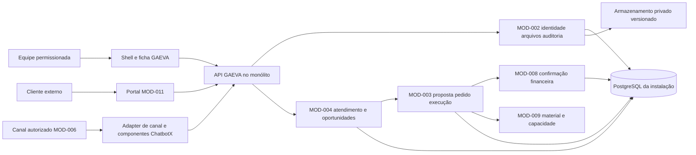

# Arquitetura proposta — GAEVA OS

GAEVA-TRANSFORM-001 / preparation/architecture revision1 / MT-A01. Responsável: TFD-architecture, [host-agent-id-omitted]. Main: [host-agent-id-omitted]. Correlação: [host-correlation-id-omitted]. **Scaffold documental para revisão; não é spec executável final, aprovação G4/G6 ou prontidão de desenvolvimento.**

## Escopo e precedência

Um produto GAEVA OS sobre FilaOps. O foco atual “isso foca só no gaeva” prevalece sobre exigir entregas por empresa nos adendos históricos Product. Instalações independentes são contexto reutilizável de configuração, não outra frente, fork ou requisito de tenancy compartilhada. Materiais e processos não são definidos pela marca. Mantidos 11 módulos e Fundação → Plataforma → piloto Comercial; contratos MOD-003/006/008/011 fazem parte da preparação do piloto. A raiz B é a fonte pretendida; A permanece inteira.

Entradas congeladas: Product documental r3, Discovery MT-D01 revision2, revisão independente mt-d01-r2 PASS limitado F-01/F-02. Manifesto e hashes no [recibo](../../../external-references.md#ref-40f72a91b253); IDs E/DEP/Q abaixo vêm de `docs/discovery/gaeva-transformacao/{findings.md,evidence.json,sources.json}`. REQ-01–16 são rastreabilidade da proposta Product, não novos requisitos aprovados em bloco. COM-001–029/MF-01–44/KP permanecem com seus IDs. Não há alteração de ledgers: Comercial tem apenas submit G0, phases vazio. Mandato documental permite esta preparação sem fingir G0/G0.5/G1/G6 ou satisfazer branch/PR/CI do projeto.

## Estado existente versus alvo

**Existente observado:** FastAPI único (`backend/app/main.py:204–211,384,558–606`), agregador de rotas, SQLAlchemy/PostgreSQL e serviços de domínio; registro dinâmico opcional `register(app)` por configuração, não hot-plug do Core. `plugin_registry.py` anuncia tier/features; não concede permissão. `/admin/messages` monta AdminNotifications, com componentes Atendimento parciais. Notification não é conversa omnichannel completa; `Customer` organizacional não é `User` cliente. OPs/recursos/unidades/pagamentos são capacidades reutilizáveis, não implementação dos gates GAEVA. DEP-01–13 documentam essa diferença.

**Alvo proposto:** manter monólito modular, uma autoridade de domínio por escrita e PostgreSQL lógico único dentro da instalação. Interface GAEVA, ERP e Comercial operam os mesmos registros por serviços/adapters. ChatbotX continua base escolhida para Comercial; integrar componentes e contratos elegíveis do snapshot `00d8b488074d4112e799c24fa516b46adf8f6c25`, adaptar lacunas, sem reconstruir chat do zero. Q03 exige provar compatibilidade de schemas, identidades, migrações, runtime e dependências antes de incorporar componentes. Não se prescreve transplantar todo o runtime ChatbotX para Python, nem declarar serviço independente implantado ou segundo banco por conveniência. Caso o componente exija runtime auxiliar, MT-A02 deve documentar necessidade, contrato e custo preservando autoridade única; não é microserviço por módulo nem decisão de implantação nesta entrega.

## Contexto e componentes (C4 resumido)

O diagrama é lógico proposto, não inventário de processos instalados. Conteúdo externo passa por adapter; navegador, IA e plugin não escrevem diretamente tabelas de ERP. Sem obrigação de fila distribuída, broker, outbox ou novo framework. Chamadas locais transacionais primeiro; somente efeitos externos precisam de registro durável de tentativa e reconciliação. UI não é autoridade de estado.

## Donos de domínio e dados

Ownership abaixo é contrato proposto; nomes de tabelas existentes foram encontrados em `backend/app/models`. Novas entidades são **conceituais propostas**, sem DDL aprovado. Consultas cruzadas por projeção autorizada são permitidas; escrita cruzada por SQL de outro domínio não.

| Dono | Persistência existente/candidata | Escrita exclusiva proposta / interfaces |
| --- | --- | --- |
| MOD-002 Plataforma | `users`, `refresh_tokens`, `password_reset_requests`; arquivos/ACL novos a especificar | Autenticação, vínculo tipado, ação por registro/campo, último Admin, configurações e auditoria. Não confundir role atual com nova alçada |
| MOD-003 Venda/Pedido/Produção | `sales_orders`, `sales_order_lines`, `production_orders`, `production_order_operations`, `production_order_materials`, `scrap_records`, `qc_inspections`, `order_events`; propostas/versões a reconciliar | Briefing, revisão aceita, pedido, execuções filhas, decisão técnica, qualidade e passagem produtiva; expõe gate operacional sem financeiro sensível |
| MOD-004 Comercial | `notifications` como legado compartilhado sob compatibilidade; conversation/opportunity/assignment/invitation/identity-map conceituais | Conversa, principal, colaboração, oportunidade, fila e reservas. Não escrever Payment/OP por arraste. Avisos de sistema continuam produzidos pelos serviços atuais via interface preservada |
| MOD-006 Canais | IDs e eventos externos conceituais; schema real ChatbotX/PRO UNKNOWN | Origem, conexão, elegibilidade, recebimento/entrega externa, deduplicação e reconciliação. Não aprova proposta ou pagamento |
| MOD-008 Financeiro | `payments`, vínculos invoice e ledger a reconciliar com T03 | Recebimento confirmado, estorno e saldo; adapter PSP/manual autorizado; publica somente gate operacional aos demais |
| MOD-009 Estoque/Compras | `products`, `boms`, `bom_lines`, `inventory`, `inventory_transactions`, `purchase_orders`, `purchase_order_lines`; `resources`/`routings` usados por MOD-003 | Estoque/movimento/compra por serviço; MOD-003 coordena alocação produtiva. Unidade/custo passam por uom_config; nenhum cadastro duplicado para fila |
| MOD-011 Portal | Reuso identidade e projeções; convite/acesso conceituais | Sessão cliente e apresentação publicada; decisões de aceite via MOD-003, nunca escrita direta em tabelas ERP |
| MOD-005/007/010 | Ações comerciais / Fiscal / Folha, cobertura parcial ou desconhecida | Roadmap: leituras/eventos permissionados, documento fiscal próprio e folha após PRD. Invoice não vira NF-e/NFS-e por rename |

Proposta técnica: serviços coordenadores recebem transação/unidade de trabalho; serviços internos não fazem commit oculto. Hoje `notification_service.py` faz commits e confirmação de pedido produz aviso depois do commit (DEP-09): não declarar atomicidade já existente. Mudança futura mínima no fluxo afetado, com teste de falha/reconciliação; não refatorar todo o monólito para obter pureza arquitetural.

## Identidade, autorização e ameaças concretas

Vínculos tipados entre `User.id` funcionário, `User.id` cliente portal, `Customer.id` organização, contato externo, conversa, oportunidade, pedido e thread legado. Mesmo valor numérico não prova equivalência. Fonte atual `notification_context_service.py:1–57` usa Notification → SalesOrder.customer_id → User cliente e recusa inconsistência; conservar sem fallback por nome/e-mail, telefone ou `user_id` do pedido. T01 testa a projeção e nega operator/customer.

Plataforma decide permissão; Comercial decide participação vigente; ERP/Financeiro filtram campos. Admin, Gerente, Produção, Designer e cliente são atores de produto; vendedor/técnico são capacidades atribuídas. Novas alçadas seguem `decisions.md`, sem promover operator para admin. Autorização é revalidada em leitura, comando, download, exportação, websocket/evento e contexto de IA. Cache/chaves incluem escopo e revisão de acesso; revogação impede novas leituras/envios. Menção não concede acesso. Convite pendente não concede acesso; aceite não dá direito de devolver bot a ex-principal. Desativar usuário revoga sessão/novas ações e conserva autoria; transação impede remover/desativar último Admin ativo.

Threads internos, assistência IA privada, mensagem pública do canal, aviso operacional e evento técnico UI têm audiências distintas. Allowlist de campos por projeção impede custo/margem/condição financeira em tela Produção, tooltip, evento, busca ou prompt IA. Download exige objeto existente + vínculo + audiência atual, mesmo com URL antiga. Controles CSRF/sessão, assinatura de webhook, MIME/tamanho/processamento de mídia e rate limit devem ser demonstrados no contrato real, não presumidos pelo mock.

## Qualidades verificáveis e observabilidade

| Driver | Aceite projetado / teste futuro | Limite atual |
| --- | --- | --- |
| Continuidade | IDs/fontes mapeados sem colisão, zero mensagem/anexo contratado perdido, conciliação de totais/links e hashes em ensaio | Q05 e constraint efetiva não verificadas |
| Concorrência | Em disputa assumir/pausar/aceitar, um principal e ocupação nunca acima do limite; callback/command repetido tem um efeito | Teste PostgreSQL isolado ainda não executado |
| Privacidade | Negação por URL/evento/arquivo/IA sem dados restritos; contexto A/B nunca apresenta resposta atrasada de A | Reusar T01/T02, ampliar para novas audiências |
| Recuperação | Restaurar DB+objetos+config em destino autorizado, reconciliar e exercer jornada; rollback preserva escritas aceitas | Backup ENV08 íntegro; restore NÃO TESTADO |
| Operabilidade | Manifesto fonte-hash→build→digest e ambientes com recursos exclusivos; migrations com um executor | .git B negado; imagem-fonte não provada |
| Experiência | Mesmos dados na ficha/visões, sem perda de rascunho/seleção; teclado e zoom200% na jornada | UX/QA visuais pendentes |

Metas de latência, concorrência nominal, disponibilidade, RPO/RTO e custo VPS não foram definidas/medidas: DevOps deve propor orçamento e baseline; não usar números fictícios como SLO aprovado. Registrar correlation_id, operation_id, domínio, ator tipado, revisão, transição, resultado e motivo permitido; métricas de duplicata/conflito/falha de canal/reconciliação/idade da fila, sem corpo de conversa, documento ou segredo em logs. Auditoria durável distinta de toast e logs. Evento negado também audita sem revelar existência ao solicitante. Rollback tem evidência e reconciliação, não só “container healthy”.

## Migração, compatibilidade e retorno

Expandir/adaptar/contrair por fase, sem apagar tabela. Inventariar primeiro DEP-01–13 e PRO/anexos com responsável; mapear `(origem, tipo, id_legado)` para ID canônico com unicidade e quarentena de colisões/órfãos. Preservar corpo/autoria/origem/datas, vínculo pedido/cliente, leitura global e anexos autorizados, sem converter leitura global em recibo individual ou do canal. Ordenação empatada precisa regra determinística validada, não alterar histórico silenciosamente.

Adapters preservam `/admin/messages`, APIs de notificações, contador/dashboard e produtor system enquanto houver consumidor. Entrada/nav migra para Comercial após aceites; não nasce módulo Mensagens permanente paralelo. Não desativar sino/toaster/notificações operacionais. Notification.sales_order_id declara CASCADE: proibir delete de pedido/tabela no rollout até plano de retenção/constraint e reconciliação específico; nenhuma perda real alegada. Redirecionamento mantém contexto por mapa, nunca busca aproximada por cliente.

Plano futuro: (1) snapshot/proveniência e baseline sintético; (2) migrações aditivas e adapters sem escrita dupla autônoma; (3) dry-run de mapa e relatório de conflitos; (4) fixtures de continuidade e falhas; (5) habilitar superfície para grupo autorizado, com caminho anterior reversível; (6) reconciliar novas escritas; (7) retirar apenas endpoints substituídos após inventário sem consumidores e aceite específico. Arquivos legados ficam privados; se URL mudar, resolver autorizado. Unknown PRO/Q05 bloqueia corte dependente, não toda documentação.

Rollback prefere imagem anterior com schema aditivo compatível e feature de entrada revertida. Versões aceitas, pagamentos e mensagens enviados não são “desfeitos”; reconciliar efeitos externos. Downgrade destrutivo ou restore sobre produção exige plano/autorização próprios. Preparar ensaio isolado de backup completo, com manifestos/contagens/vínculos e recuperação funcional; não acessar backup privado nesta tarefa. ENV04/05/08 são evidência relatada dos respectivos executores, não revalidação operacional deste setor.

## Decisões e próximas entradas

ADRs/alternativas e políticas propostas em [decisions.md](decisions.md); contratos em [contracts.md](contracts.md); fases, rastreabilidade, estimativas e handoffs em [phase-plan.md](phase-plan.md). MT-A02 deve integrar UIUX/DevOps, fechar OpenAPI/esquema físico por recorte e gerar/atualizar a única Task de cada módulo após inventário e aprovação correspondente. Nenhuma dessas tarefas canônicas é criada por MT-A01.
