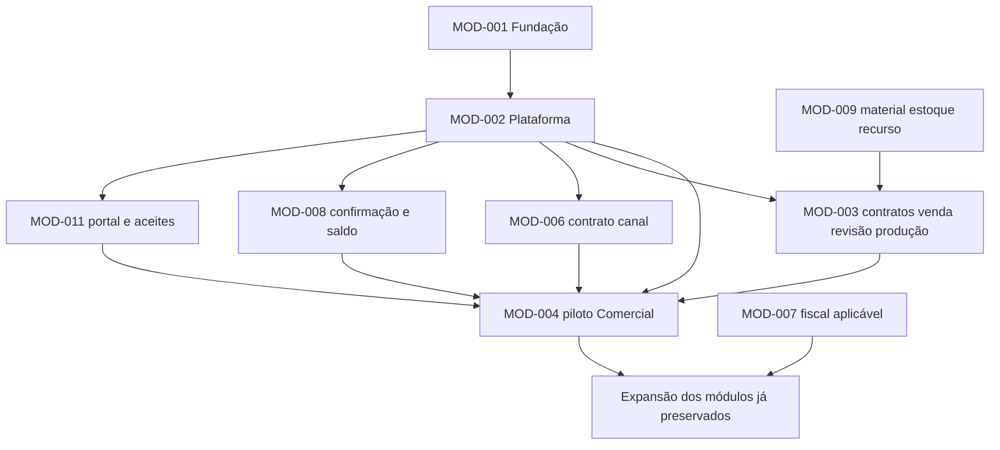

# Plano faseado, rastreabilidade e handoffs — r2

GAEVA-TRANSFORM-001 / preparation/architecture revision2 / MT-A01. Substituição1 restrita a F-01, correlação9033a396-6d6e-4395-8283-87de34950b70. Scaffold de fases para síntese MT-A02, sem criação/alteração de Task JSON, workflow ou implementação. Leitura das normas não é autorização de transição. Main coordena; QA independente não é autor deste pacote.

## Inventário antes de gerar Tasks

Busca estática `rg --files docs -g '*[Tt][Aa][Ss][Kk]*' -g '*workflow*' -g '*plano-de-execucao*'`: existem10 pares históricos `docs/execution/TASK-*.json` e `docs/tasks/TASK-*.md` (shell/painel/navegação/guias), além de `docs/planejamento/plano-de-execucao.{json,md}` e legado TASK-037. O plano histórico associa MOD-001–011 a `A_VINCULAR_MOD-xxx`; isso não é Task moderna gerada. Único workflow encontrado no recorte `docs/gaeva`: `modulos/comercial/workflow.json`, com phases vazio e somente submitG0. Não acessar .git para resolver esse inventário, nem alegar inexistência de Tasks fora do domínio pesquisado.

MT-A02/main deve resolver um caminho/ID canônico por módulo, reutilizar qualquer Task efetiva localizada e registrar substituição de placeholders no mesmo plano quando autorizado; gerar visão a partir do JSON único e usar render/validator existentes antes de transição. Estes documentos não são um segundo ledger/Task. Manter snapshots/revisões de Discovery/spec/Task correspondentes e reviewer distinto. Nenhuma aprovação humana é inferida de submit ou QA Discovery.

## Dependências e fases propostas

Setas representam pré-condições do recorte integrado, não autorização para executar todos os módulos em paralelo. Contrato pode ser preparado antes da implementação do módulo completo; piloto não pode fingir confirmação/aceite/canal real por mock. Fonte/proveniência e banco de teste seguro antecedem qualquer execução futura. Uma frente por vez sob despacho do main.

Estimativas abaixo são **intervalos propostos de esforço humano equivalente em dias de6h, O/M/P**, não prazo, orçamento ou capacidade acordados. Base: quantidade de fronteiras/fixtures inventariadas, não medição histórica; confiança baixa devido Q02–05, políticas e código externo não inspecionado. Não somar como calendário multiagente; recalibrar em MT-A02 após UIUX/DevOps e fixture técnica. Não há estimativa de horas já consumidas.

| Fase proposta / módulos | Saída concreta | Donos futuros e revisão independente | O/M/P dias / parada |
| --- | --- | --- | --- |
| F1 Fundação, MOD-001 | Manifesto fonte/lock/build/digest, desenho dev/test/prod e CI, ensaio isolado planejado de recuperação, contratos de migration única e rollback | DevOps, Database; qa_backend + Security e main; sem execução neste mandato | 3/6/12; não avançar execução se teste toca produção ou imagem não rastreável |
| F2 Plataforma, MOD-002 | Identidades/mapa, RBAC de ação/registro/campo, arquivos/ACL, autoria/auditoria, shell e contexto compartilhado | Architecture, Backend/Database, Frontend/UIUX; qa_backend, qa_ui, Security | 5/10/20; matriz sensível e fixture identidade obrigatórias |
| F3 Contratos verticais do piloto, MOD-003/006/008/011 | OpenAPI/estado/revisão/gates e adapters ChatbotX/PRO/canal/PSP/Portal selecionados, dados sintéticos de integração | Architecture com donos Backend/Database e Security; qa_spec antes da aprovação humana de implementação | 4/8/16; contrato externo ausente bloqueia apenas adapter dependente |
| F4 Piloto Comercial, MOD-004 | Atendimento e Kanban sobre registros únicos; fila/humano/bot; retirar entrada Mensagens gradualmente após C00; catálogo/briefing/publicação/contexto do recorte | Backend/Frontend/Database e UIUX; qa_backend, qa_ui, Security, human review | 8/16/32; sem transporte ou preservação comprovados não anunciar funcional completo |
| F5 Jornada produtiva e portal, aprofundar MOD-003/011/009 | Peças/revisões/OPs filhas, KP-01, impressão separada, aprovações cliente/técnico/QC e postagem integral | Donos domínio, Database/Backend/Frontend; QA aplicáveis e revisão humana por fase | 8/15/30; decisão agregação e gate completo antes de avanço dependente |
| F6 Expansão, MOD-005/007/008/009/010/006 | Roadmap abaixo, com recortes e PRDs próprios; não bloco de implementação | Main/harness resolve próximas dependências e mantém um Task por módulo | 5/12/25 apenas preparação de expansão; implementação não estimável sem recortes |

## Roadmap dos11 módulos, sem redução silenciosa a MVP

| Módulo preservado | Primeiro recorte / continuidade |
| --- | --- |
| MOD-001 Fundação | F1 e prontidão versionada; manutenção de proveniência/restore por release |
| MOD-002 Plataforma | F2 identidade/RBAC/arquivos/shell; políticas de segurança e auditoria transversais |
| MOD-003 Venda/Pedido/Produção | F3 gates mínimos ao piloto, F5 aprofundamento integral de produção/peças/tempos e expedição |
| MOD-004 Comercial | F4 atendimento/fila/oportunidades/ficha; agenda/IA/relatórios e capacidades MF no backlog final rastreado, sem sumir por MVP |
| MOD-005 Ações comerciais | Depois de fatos/eventos do piloto, atribuição de campanhas e métricas/metas sem duplicar CRM; fórmulas a fechar |
| MOD-006 Canais | F3 canal escolhido e eventos; ampliar voz/Calling/Flows/edição somente com capacidade/licença/contrato demonstrados |
| MOD-007 Fiscal | Contrato aplicável à expedição e contexto de documento; emissão brasileira após responsável/enquadramento/integração, sem equivalência Invoice |
| MOD-008 Financeiro | F3 confirmação/entrada/saldo; conciliação, estorno/recebíveis e relatórios aprofundados depois, sem alterar regra50% |
| MOD-009 Estoque/Compras | Contratos de material/recurso ao gate, depois MRP/compras/perdas/custos com UOM e estoque reconciliados |
| MOD-010 Folha | Definir PRD/aplicabilidade/cobertura e prioridade antes de spec ou estimativa de implementação; sem solução presumida |
| MOD-011 Portal | F3 identidade/acesso/publicação/aceites por revisão, F5 jornada completa do cliente com mesmos registros filtrados |

## Aceites e testes planejados (não executados)

| REQ Product / fonte e contrato | MT local de síntese futura / AC | TEST futuro e resultado esperado |
| --- | --- | --- |
| REQ-01/06, S1/S4, E03–05; C02 | A02-CONTEXTO / AC01 | T01: cadeia exata, thread A/B, IDs contraditórios/órfãos, retorno à ficha; sem duplicata ou vazamento, 404/403 corretos. Reusar `test_notification_context.py` e AdminNotifications.test.jsx |
| REQ-07/10, S1/S4/U02; C02/C06 | A02-PLATAFORMA / AC02 | T02: ator/campo/objeto/download/export/evento/IA negados; último Admin concorrente; autoria desativada preservada; teclado/zoom/foco sem prender drawer modeless |
| REQ-04/05, COM-014–026/r42; C03 | A02-ATENDIMENTO / AC03 | T03: assumir/pausar/aceitar/redistribuir sob concorrência, principal único/capacidade, clocks separados, bot fence, convite pending sem ACL, encerramento preserva histórico. PostgreSQL de teste allowlisted, canal fake explícito |
| REQ-03, COM/publicação; C04 | A02-PROPOSTA / AC04 | T04: IA rascunho sem publicar, vendedor publica revisão, aceite anterior não vale para revisão nova, mover funil não confirma pedido/pagamento |
| REQ-02/08/09/15, MOD-003r10 e KP; C04/C05 | A02-GATES / AC05 | T05: catálogo antes personalização;2D/proposta→recebimento→3D cliente+técnico→produção→QC/foto final→saldo/postagem; negativos de cada gate e revisão/quantidade; OP filha sem nova venda; paralelismo não soma horas como prazo |
| REQ-11/12, DEP-01–13; C00/C06 | A02-PRESERVACAO / AC06 | T06: fixture com system/customer/admin, contexto/contador/read_at, links antigos e anexo privado; hashes/IDs/campos/autoria antes/depois, conflito e CASCADE em ensaio; zero perda contratada, sem toast virar conversa |
| REQ-14 e contexto REQ-16; ADR07 | A02-FUNDACAO / AC07 | T07: manifesto B→imagem, config isolada, DB test allowlist, único migrador, restore autorizado DB/objetos/config e rollback com reconciliação. Não usar runtime saudável ou backup TOC como resultado do ensaio |
| REQ-13/15 e COM/MF/U01–03; C03/C04 | A02-EXPERIENCIA / AC08 | T08: inventário hashes r38/r39/guia e estados; Kanban comercial distinto da conversa/KP/fila; ações sem arraste, rejeição restaura card/rascunho, dados indisponíveis não zero; UIUX escolhe impressão com evidência |
| REQ-16 histórico, foco atual GAEVA; ADR08 | A02-CONFIG / AC09 | T09: material/processo/UOM parametrizáveis, sem regras por marca; templates reutilizáveis não cruzam recursos/configuração. Não exigir dois produtos ou operações de outra empresa nesta entrega |

Os nomes A02-* e T/AC são locators deste scaffold para a síntese, não novas Tasks executáveis ou renumeração das COM/MF. QA deve validar rastreabilidade final no schema canônico e nos testes efetivos da fase, incluindo resultados negativos. Não correr suítes que importam app ou bootstrap DB antes de ambiente seguro aprovado.

### Complemento F01-IDEM — C01, A02-ATENDIMENTO/AC03/T03 e comandos transversais

Verificações futuras propostas, não executadas; aplicam-se ao envelope C01 também em proposta, arquivo e confirmação financeira, sem nova Task ou enumeração COM/MF:

| Caso | Resultado esperado do contrato proposto |
| --- | --- |
| Mesma chave/ação/payload vazio: sucesso em conversation A, depois target B |409 IDEMPOTENCY_CONFLICT; nenhum efeito em B, nenhum replay do sucesso de A como resposta a B |
| ID representado igual sob tipos de alvo diferentes; número versus string não equivalentes pelo schema |409 na mesma chave; identidade tipada não colide nem cria segundo efeito |
| Mesmo alvo, expected_version alterada; payload, motivo, seletor/opção semântica ou command_schema_version alterados |409 na mesma chave, sem expor resultado original; corrigir pedido exige nova operação após saber resultado anterior |
| Retry exato após sucesso persistido, agregado já avançou de versão |Mesmo status/resultado original autorizado, vinculado à identidade/versão original; sem nova escrita/despacho nem VERSION_CONFLICT causado pela versão hoje defasada |
| Retry exato após rejeição de domínio admitida e confirmada sem efeito |Mesma rejeição terminal; mudança semântica exige nova chave e novo CAS, não transforma retry em execução |
| Duas tentativas simultâneas, mesma identidade; outra tentativa mesma chave com alvo diferente |Um executor; concorrente exato202 referencia mesma operação até terminal, divergente409; nunca dupla aplicação |
| Timeout/falha depois de possível efeito, pending ou outcome_unknown |Consulta/reconciliação da operação original; nenhum reenvio cego ou sucesso presumido; após resolver, retry exato retorna resultado terminal |
| Autorização revogada para ação, alvo ou campos do resultado entre execução e retry |Negação segura sem conteúdo original, sem reaplicação; revalidação de outro alvo não dá acesso ao original |
| Credencial/input inválido antes de admissão; chave fora da retenção suportada |Sem recibo/efeito pré-admissão; não reaplicar chave antiga como nova após expiração: comportamento tombstone/rejeição a detalhar, sem inventar TTL |

Fixtures devem fixar identidade canônica, operação/resultado originais e versão corrente separadamente. Comparar efeito único e ausência de vazamento, não apenas HTTP200. Estes aceites fecham a ambiguidade documental F-01 para recheck independente, não provam correção de código inexistente.

## Handoff UIUX ao main — despacho posterior, não iniciado aqui

Entrada: `docs/design/{index.html,design-guide.md}`, mockup Comercial index r38/r39 e assets vinculados, PRD Comercial42/spec23/matriz11 harmonizada pela Discovery, KP-01/02/04 e C00–06. UIUX deve congelar hashes dos assets realmente reutilizados e ler fontes completas aplicáveis de tokens/padrões, sem nova biblioteca só por estar citada no guia.

Saída requerida: matriz tela→componente/token→ação→estado→permissão→contrato→teste. Reusar shell/nav e Atendimento já desenhados; drawer global modeless sem backdrop/aria-modal/focus trap, seleção/rascunho preservados; ação distinta Prévia/Abrir ficha. Kanban Comercial mantém seis etapas/Ganho-Perdido, conversa tem fila/posse e não o mesmo estado; Produção sete colunas com Aguardando antes início; fila impressão lista/híbrido/Kanban justificada por recurso/densidade/bloqueios, sem inventar ordenação. Comparar opção lista com Kanban e recomendar, sem pedir ao usuário desenho.

Cobrir carregamento, vazio, erro recuperável, envio desconhecido, não integrado, permissão negada, conflito de versão, gate bloqueado, pending/aceito/recusado de convite, teclado equivalente ao arraste/resize, foco/restauração, móvel/temas/zoom200%, leitor de tela. Causas sensíveis filtradas e fixtures rotuladas. Aceite visual não decide D01–08 nem homologa canal. Entregar handoff para Frontend e checks qa_ui; sem implementar nesta etapa.

## Handoff DevOps ao main — desenho seguro de desenvolvimento

Entradas ENV04/05/08 e Q02/Q04; B pretendida, A preservada, .git negado sem retry. Pedir evidência canônica de repo/commit somente por responsável autorizado; enquanto indisponível usar manifestos integrais de contexto com hash e marcar status Git não verificado. Tag/label não substitui correspondência fonte-imagem. Não publicar repo ou ativar VPS.

Especificar artefatos futuros (nomes propostos, não arquivos criados): manifestos de build/release, exemplos de parâmetros sem segredo, variantes Compose dev/test/prod e CI. Configs têm versões e parâmetros de origem/mount/rede/volume próprios; nomes fixos atuais impedem presumir isolamento apenas por project name. Teste não reutiliza filaops_pgdata, filaops_config ou B/uploads nem porta/config de produção. Secrets fora do repo/exemplos/logs; versão/digest do plugin e dependências registrados, sem baixar latest no startup para build supostamente reproduzível. Revisar backend ranges e lock Node/requirements existentes antes de propor pin, sem instalar agora.

Checks futuros: parser/validador estático de configs sanitizadas; allowlist explícita host/porta/nome/usuário DB teste mais recusa prod e credencial distinta; CI sem credencial produção, dataset sintético, DB efêmero exclusivo; migrations com único executor e aplicação sem privilégios DDL após deploy. Atual entrypoint também roda Alembic além do migrate: resolver duplicidade no design, não declarar segurança por depends_on. Ensaiar upgrade e retorno com schema expandido, timeout/lock/falha, backup DB+objetos+identidade/config consistente e restore em destino descartável autorizado, reconciliação e smoke de jornada. Medir volume/carga/tempo para propor VPS/RPO/RTO e orçamento, sem tamanho de máquina inventado. Não repetir operações existentes para preencher recibo.

## Gates e condições de entrega

MT-A01 entrega estes cinco documentos locais para QA independente; MT-A02 recebe UIUX/DevOps e síntese do main. qa_spec compara revisão/hash e dependências, devolve achados específicos; executor corrige apenas escopo solicitado e ressubmete, limite canônico de três substituições. Este autor não emite PASS. Fases de implementação só depois de spec/Task/Discovery correspondentes, QA aplicável e aprovação humana; cada fase segue execução/self-test → QA independente → rework → PASS → revisão humana. Sem publicação, commit/push/merge, deploy ou runtime autorizado nesta preparação.

Não rodar pipeline validator como se houvesse transição neste MT: nenhum ledger foi alterado/submetido e Task ainda não foi gerada. Main deve executá-lo ao compor o contrato canônico. Documentação de usuário final será do setor Documentation após comportamento verificado/revisado; este pacote é desenho interno.
